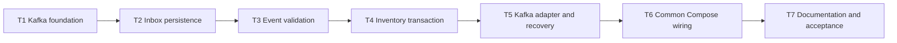

# Async Reservation Cancellation Inventory Consumer Implementation Tasks

Status: Inventory consumer task decomposition defined; ready for implementation.

This plan implements Inventory's portion of `requirements.md` through the decisions in
`design.md`. T1-T5 and T7 are separate commits in `rent-flow-inventory`; T6 is one separate commit
in `rent-flow-common`. Every task includes its scoped change and the automated checks or
documentation needed to leave its repository in a safe, reproducible state.

## 1. Execution contract

- Execute T1 through T7 in numeric order. Do not combine tasks or split a task's implementation
  from the tests that prove it.
- Complete one task and satisfy its full DoD before creating its proposed commit or starting its
  successor. Do not mix changes from the two repositories in one commit.
- Before every Inventory commit, run `mvn -B -ntp clean verify` without test, integration-test,
  migration, Kafka, or formatting skip flags. If Spotless fails, run `mvn spotless:apply` and
  repeat the full clean verification.
- T6 runs `./scripts/container-smoke-test.sh` from `rent-flow-common` and must end with
  `Combined container smoke verification passed`. T7 repeats that cross-repository smoke test as
  part of final acceptance after the Inventory clean verification succeeds.
- Use explicit Java types for local variables and enhanced `for` loops. Preserve unrelated code,
  user-owned changes, and all existing HTTP, history, migration, and idempotency behavior.
- Keep the exact Kafka names, JSON contract, failure codes, database schema, retry defaults, DLT
  headers, and metric labels from `design.md`. Any discovered gap or changed decision goes to the
  spec before code.
- The source topic is never created through broker auto-creation or by Inventory production code.
  Tests and the common smoke script may create it explicitly as isolated test infrastructure.
- The Inventory consumer starts automatically by default and tolerates missing source-topic
  metadata as specified in `design.md` §4.1 and §7.1; do not add a feature flag.
- No task adds a Reservation endpoint, Reservation persistence, a producer relay, a result event,
  automatic DLT replay, a schema registry, a shared event-class library, or production secrets.
- The proposed titles use Conventional Commits and define the intended scope of each commit.

## 2. Dependencies, repository boundary, and delivery order

### 2.1 Task dependency graph

The order is intentionally linear. T1 establishes managed dependencies and validated settings;
T2 creates the durable receipt foundation; T3 freezes the untrusted wire boundary; T4 implements
the database effect without an active consumer; and T5 activates consumption only when complete
retry and DLT recovery are present. T6 then proves container wiring in the common repository, and
T7 documents and verifies the completed Inventory side. Every repository checkout at a task
boundary builds and has tests for all behavior enabled at that point.

### 2.2 External integration assumption

This plan deliberately contains no Reservation implementation task. A real cancellation workflow
requires a compatible future producer in `rent-flow-reservation`, with the transaction/outbox and
publication properties recorded as assumptions in `requirements.md` Context and `design.md` §3.

Inventory implementation and local smoke verification do not wait for that feature. Inventory's
contract tests and T6's explicit test producer provide deterministic records in the meantime, but
neither is evidence that Reservation satisfies its future outbox obligations. Completion of T1-T7
means the Inventory consumer and common local wiring satisfy this plan; Reservation compatibility
is an external integration dependency, not an acceptance criterion or task-plan blocker here.

## 3. Implementation tasks

### T1 - Establish the Kafka dependency and configuration foundation

**Repository:** `rent-flow-inventory`.

**Commit:** `build: add inventory kafka consumer foundation`

**Depends on:** None.

**Refs.** `requirements.md` AC1.8, AC3.2-AC3.3, AC4.6;
`design.md` §1.1-§1.3, §2.1, §4.1, §6.2, §7.1, §11.1.

**Scope.**

- Add the Spring Boot-managed `spring-boot-starter-kafka` production dependency plus
  `spring-boot-starter-kafka-test` and `org.testcontainers:testcontainers-kafka` test
  dependencies. Do not add independent Spring Kafka or Testcontainers versions.
- Add the exact `spring.kafka` byte-array consumer/producer settings and externally overridable
  topic, group, payload, concurrency, and retry defaults from `design.md` §4.1.
- Add a typed, validated configuration-properties model for the Inventory cancellation consumer,
  including the one-to-five attempt bound and valid backoff relationships.
- Add no listener, Kafka admin topic bean, database migration, event parser, or inventory behavior
  in this task.

**DoD.**

- Maven resolves Spring Kafka 4.1.0 through Spring Boot 4.1.0 and Testcontainers Kafka through the
  existing 2.0.5 BOM; `pom.xml` contains no duplicate version pin, schema-registry client, Avro,
  Protobuf, Kafka Streams, or transactional-database bridge dependency.
- Default configuration binds the exact source topic, DLT, consumer group, three-way concurrency,
  4096-byte payload limit, five attempts, and 1-second initial, 2x multiplier, and 8-second maximum
  backoff from `design.md` §4.1.
- Configuration tests prove valid environment overrides bind and invalid attempts below one or
  above five, negative durations, multiplier below one, and maximum backoff below initial backoff
  fail startup with a bounded validation error.
- Consumer configuration has `enable-auto-commit=false`, `auto-offset-reset=earliest`, record
  acknowledgement, synchronous offset commits, byte-array deserializers, automatic startup, and
  nonfatal missing-topic behavior. Producer configuration has byte-array serializers, `acks=all`,
  and idempotence.
- Broker auto-topic creation remains disabled by platform policy, no application listener starts,
  and existing Spring contexts, HTTP behavior, OpenAPI, architecture checks, and PostgreSQL tests
  remain unchanged.
- `mvn -B -ntp clean verify` finishes with `BUILD SUCCESS`.

### T2 - Establish durable cancellation inbox persistence

**Repository:** `rent-flow-inventory`.

**Commit:** `feat: add reservation cancellation inbox`

**Depends on:** T1.

**Refs.** `requirements.md` AC1.9, AC2.1, AC2.4, AC2.7, AC4.7;
`design.md` §4.3-§4.4, §5.1-§5.2, §7.2, §10, §11.2.

**Scope.**

- Add append-only `V4__create_inventory_reservation_cancellation_inbox.sql` with exactly the
  Inventory-owned table, columns, defaults, primary key, and checks from `design.md` §5.1. Do not
  edit V1-V3.
- Add the immutable `InventoryReservationCancellationReceipt` entity, its string outcome enum,
  and `ReservationCancellationInboxRepository` with primary-key lookup, insert/flush, and the
  native transaction-scoped advisory-lock operation.
- Extend migration cleanup and PostgreSQL integration coverage for the receipt mapping,
  constraints, generated processing timestamp, retention across item deletion/restart, and lock
  behavior. Do not add the Inventory service method yet.

**DoD.**

- Flyway records V4 exactly once in `inventory.flyway_schema_history`, creates only
  `inventory.inventory_reservation_cancellation_inbox`, and leaves V1-V3 and the other-service
  sentinel unchanged. No application or Flyway object is created in `public` or another service's
  schema.
- Catalogue assertions prove the exact UUID primary key, 64-character lowercase fingerprint,
  64-character serial, `timestamptz occurred_at`, bounded outcome, and PostgreSQL-defaulted
  `timestamptz processed_at` contract from `design.md` §5.1.
- Direct inserts reject null or invalid IDs, fingerprints, serial numbers, and outcomes. Valid
  rows receive a database timestamp, survive a second application context, and remain after their
  current inventory item is deleted.
- Metadata inspection proves the primary key is the only index and there is no item foreign key,
  payload column, reservation identifier, expiry column, cleanup index, update query, delete
  repository method, or cleanup job.
- Entity tests prove assigned fields are immutable, `processedAt` is database-generated, and only
  `RELEASED` and `ALREADY_AVAILABLE` can be persisted.
- PostgreSQL integration proves the repository's blocking advisory lock is transaction-scoped:
  the same lock ID serializes concurrent transactions and becomes available after commit,
  rollback, or connection close; different lock IDs do not block each other.
- Test cleanup deletes receipts explicitly without relying on a foreign-key cascade or execution
  order, and all pre-existing migration and history-retention assertions remain green.
- `mvn -B -ntp clean verify` finishes with `BUILD SUCCESS` against PostgreSQL 18.4.

### T3 - Validate and canonicalize cancellation events

**Repository:** `rent-flow-inventory`.

**Commit:** `feat: validate reservation cancellation events`

**Depends on:** T2.

**Refs.** `requirements.md` AC1.1-AC1.2, AC2.3, AC3.1, AC3.5, AC4.4;
`design.md` §2.2-§2.3, §4.2-§4.3, §6.1, §6.3, §10, §11.1.

**Scope.**

- Add the validated `ReservationCancellationEvent` application model, processing outcome, bounded
  failure-code types, and typed rejection/retry exceptions in existing project layers. Read the
  five known wire fields directly from the parsed JSON tree rather than adding a pass-through wire
  DTO. No type stores raw Kafka key or value bytes in an exception message.
- Add `ReservationCancellationEventConverter` using a dedicated Jackson mapper and accepting the
  full `ConsumerRecord<byte[], byte[]>`. It performs strict UTF-8, size, JSON, known-field,
  timestamp, UUID v4, serial, and exact key/value validation while ignoring unknown properties.
- Add canonical SHA-256 fingerprint and namespaced advisory-lock-ID calculation, plus the bounded
  best-effort event-ID extractor needed when conversion cannot complete.
- Keep Inventory state, inbox rows, Kafka offsets, retries, DLT publication, and metrics unchanged
  in this task.

**DoD.**

- Unit tests without Spring accept the exact five-field JSON contract and key, including the
  4096-byte boundary, lowercase producer UUID, accepted uppercase UUID hex, valid UTC instants,
  serial boundary lengths, and harmless unknown fields.
- The converter rejects null/tombstone or oversized values; malformed or non-object JSON;
  non-UTF-8 key/value bytes; duplicate members; missing, null, wrong-type, or invalid known fields;
  non-v4 UUIDs; unsupported type/version; invalid timestamps/serials; null keys; and every key
  mismatch without opening a database transaction.
- Failure tests distinguish `INVALID_EVENT` from `UNSUPPORTED_EVENT` and attach a normalized event
  ID only when independently parseable. Exception messages and captured logs contain neither the
  raw payload nor raw key.
- Fingerprint tests prove JSON whitespace/order, accepted UUID case, and unknown fields produce
  the same lowercase 64-character fingerprint, while every known semantic value, timestamp,
  serial case, or decoded key change produces a different fingerprint.
- Tests prove each fingerprint component uses a four-byte big-endian length prefix and the event
  namespace; advisory lock IDs are deterministic signed 64-bit values using their separate
  namespace and do not reuse HTTP idempotency lock derivation.
- The dedicated mapper's unknown-field policy does not alter the application's strict HTTP
  `ObjectMapper`; existing unknown HTTP properties still fail as before. No Java type header is
  required or consumed.
- Architecture tests retain the existing package direction while allowing only the minimal
  cross-layer access needed for the shared bounded cancellation failure types; no package cycle or
  controller-to-repository dependency is introduced.
- `mvn -B -ntp clean verify` finishes with `BUILD SUCCESS`.

### T4 - Add the transactional Inventory cancellation operation

**Repository:** `rent-flow-inventory`.

**Commit:** `feat: release reserved inventory after cancellation`

**Depends on:** T3.

**Refs.** `requirements.md` AC1.3-AC1.7, AC2.1-AC2.4, AC2.6-AC2.7,
AC4.1-AC4.2; `design.md` §4.2-§4.6, §5, §6.1, §9, §11.1-§11.2.

**Scope.**

- Add the separate `@Transactional`
  `InventoryService.releaseAfterCancellation(ReservationCancellationEvent)` method and inject the
  inbox repository into the existing service. Do not add `ReservationCancellationService` or call
  `transitionStatus` from the new method.
- Implement advisory-lock-first duplicate detection, fingerprint-conflict rejection, item row
  locking, the `RESERVED` release, the `AVAILABLE` no-op, bounded business rejections, receipt
  insertion, history insertion only for a real transition, and an explicit final flush.
- Add Mockito service tests plus PostgreSQL transaction/concurrency tests. Do not activate a Kafka
  listener in this task.

**DoD.**

- A new event for a locked `RESERVED` item changes only status to `AVAILABLE`, saves one exact
  `RESERVED`-to-`AVAILABLE` history row and one `RELEASED` receipt, flushes, and returns `RELEASED`.
- A new event for a locked `AVAILABLE` item changes no item field, creates no history, saves one
  `ALREADY_AVAILABLE` receipt, flushes, and returns `ALREADY_AVAILABLE`.
- Missing items throw `INVENTORY_ITEM_NOT_FOUND`; `RENTED`, `INSPECTION_REQUIRED`,
  `UNDER_MAINTENANCE`, and `RETIRED` throw `INVALID_INVENTORY_STATUS`. Each rejection leaves item,
  history, and inbox state unchanged.
- A matching completed event acquires the event lock, reads the receipt, returns `DUPLICATE`, and
  neither loads nor mutates the current item. A differing fingerprint under the same event ID
  throws `EVENT_ID_REUSED` and leaves the original receipt and all lifecycle state unchanged.
- Mockito interaction order proves the advisory lock precedes inbox lookup, duplicate paths stop
  before item lookup, new paths use `findForUpdateBySerialNumber`, and the final flush exposes
  persistence errors before an outcome returns.
- PostgreSQL fault injection proves item, history, and receipt writes commit together and roll
  back together when any insert, update, flush, or transaction commit fails.
- Concurrent tests prove same-ID deliveries serialize before receipt evaluation, same-ID
  differing payloads cannot lock different items concurrently, and different IDs for one serial
  serialize through the existing item row lock without duplicate or same-state history.
- A regression test completes an event, reserves the item again, and proves a matching duplicate
  does not inspect or release the later reservation. The accepted stale-first-delivery limitation
  remains documented rather than hidden by a freshness heuristic.
- Existing `transitionStatus`, CRUD, status matrix, HTTP idempotency, history paging, OpenAPI, and
  transaction/concurrency tests remain unchanged and green; asynchronous history is visible
  through the existing history repository/API representation.
- `mvn -B -ntp clean verify` finishes with `BUILD SUCCESS`.

### T5 - Deliver the Kafka adapter, recovery, and observability atomically

**Repository:** `rent-flow-inventory`.

**Commit:** `feat: consume reservation cancellation events`

**Depends on:** T4.

**Refs.** `requirements.md` AC1.1-AC1.8, AC2.2-AC2.6, AC3.1-AC3.9,
AC4.1-AC4.4, AC4.6-AC4.7; `design.md` §1.3, §2, §4.1-§4.2, §4.6,
§6-§10, §11.1, §11.3-§11.4.

**Scope.**

- Add `ReservationCancellationListener` as the Kafka inbound adapter in `controller`; it converts
  the raw record, calls `InventoryService.releaseAfterCancellation`, records only committed
  outcomes, and contains no repository access or manual offset logic.
- Add `InventoryKafkaConfig` with one `DefaultErrorHandler`, exact retry classification and
  exponential backoff, a byte-array `DeadLetterPublishingRecoverer`, confirmed-send handling,
  stable DLT headers, failure logging, and bounded Micrometer counters.
- Add the local-profile DLT `NewTopic` declaration with the exact three-partition retention policy.
  Inventory declares no source-topic bean, automatic replay listener, result producer, or feature
  flag.
- Add unit/configuration tests and Kafka/PostgreSQL Testcontainers coverage. The listener and its
  complete retry/DLT path land together; there is no intermediate commit containing an unsafe
  consumer.

**DoD.**

- Tests use `org.testcontainers.kafka.KafkaContainer` with `apache/kafka:4.3.1`, the existing
  PostgreSQL 18.4 container, isolated consumer groups, and explicitly created three-partition
  source/DLT topics. They do not depend on the common Compose broker or Kafka auto-creation.
- A valid keyed record for `RESERVED` produces the exact item, history, and `RELEASED` receipt
  state; an `AVAILABLE` item produces only `ALREADY_AVAILABLE`; a committed matching redelivery
  returns `DUPLICATE`. Group-offset assertions prove progression occurs only after the database
  transaction commits.
- A restart test with the same database and group proves an uncommitted record is not skipped and
  a database-committed/offset-uncommitted redelivery cannot repeat history or lifecycle effects.
- Every malformed contract case from T3, event-ID reuse, missing item, and incompatible status
  reaches the same partition in the DLT without a processing retry or database effect. Tests prove
  the source offset advances only after the DLT send is broker-confirmed.
- Retry configuration tests prove the production sequence is exactly the initial attempt plus
  1-, 2-, 4-, and 8-second delays. End-to-end retry tests use deterministic short overrides: a
  controlled transient failure succeeds on a later attempt with one committed effect, while five
  failures produce `PROCESSING_RETRIES_EXHAUSTED` in the DLT.
- When DLT publication cannot be confirmed, the source offset remains uncommitted,
  `dead_letter_publish_failure` increments, and recovery succeeds after DLT availability returns.
  A crash after DLT acknowledgement may duplicate the DLT record but cannot lose the source
  failure.
- DLT assertions compare the original key/value bytes exactly and find only one copy of each
  supported header: source topic/partition/offset, consumer group, failure code, failed-at, and a
  normalized event ID only when parseable. No exception header, message, stack trace, Java type
  header, or accumulated original source header is present, except valid W3C traceparent/tracestate as specified in ../observability/design.md §4.
- Log capture proves successful DLT publication emits one structured error diagnostic with
  bounded source metadata, category, and optional event ID but never the key, value, payload,
  exception message, SQL detail, or credentials. Any separate unexpected-exception stack-trace
  diagnostic also excludes the Kafka key and value.
- The single counter family exposes only `received`, `released`, `already_available`, `duplicate`,
  `retry`, `dead_letter`, and `dead_letter_publish_failure`; no event ID, serial, offset, exception,
  or other unbounded label is registered.
- The automated replay test reads a valid business-state DLT record and republishes its original
  key/value to the source topic. After the state is corrected, Inventory processes it with the
  unchanged event ID; there is no replay endpoint, scheduled replay, or DLT listener.
- Local-profile context tests create only the DLT with three partitions, 30-day delete retention,
  and replication factor one. Default startup is automatic and does not fail when the source topic
  is temporarily absent; no source topic appears as a side effect.
- Existing HTTP operations and OpenAPI remain byte-for-byte behaviorally compatible, asynchronous
  real transitions appear through the existing history API, architecture rules remain green, and
  Inventory emits no cancellation-result event.
- `mvn -B -ntp clean verify` finishes with `BUILD SUCCESS` without production backoff sleeps in
  the test suite.

### T6 - Wire Inventory to Kafka in the common local stack

**Repository:** `rent-flow-common`.

**Commit:** `chore: wire inventory kafka consumer locally`

**Depends on:** T5.

**Refs.** `requirements.md` AC1.1, AC1.8, AC2.2, AC4.1-AC4.2, AC4.7;
`design.md` §2.1-§2.4, §7.1, §10, §11.4.

**Scope.**

- Update only the Inventory service in `compose.yaml` with
  `KAFKA_BOOTSTRAP_SERVERS=rentflow-kafka:19092`, the `local` Spring profile, and a healthy-Kafka
  dependency while preserving its existing PostgreSQL dependency and credentials.
- Extend `scripts/container-smoke-test.sh` to create the source topic explicitly as test
  infrastructure, publish a correctly keyed version-1 cancellation event, and verify Inventory's
  asynchronous release and duplicate suppression through public behavior. Do not add source-topic
  creation to Compose or Inventory.
- Preserve the common broker's Apache Kafka 4.3.1 KRaft topology, listeners, loopback host binding,
  volume, health check, and disabled automatic topic creation. Do not modify unrelated services or
  user-owned untracked Kafka notes.

**DoD.**

- `docker compose config --quiet` succeeds and resolves Inventory's bootstrap address to the
  internal listener without exposing credentials or changing the host listener.
- Compose starts Inventory only after both PostgreSQL and Kafka are healthy; the Inventory
  container activates `local`, creates its DLT explicitly, and does not create the source topic.
- The smoke harness explicitly creates the three-partition, seven-day source topic as a test
  fixture and verifies the Inventory-created DLT has three partitions and 30-day delete retention.
  Broker auto-creation remains false.
- The smoke harness creates a dedicated `RESERVED` item, publishes the exact JSON value with the
  exact case-sensitive serial key, polls boundedly until the public Inventory API reports
  `AVAILABLE`, and proves one `RESERVED`-to-`AVAILABLE` history entry is visible.
- The harness reserves that item again, republishes the same event ID/key/value, and proves the
  durable inbox suppresses the duplicate so the later reservation remains `RESERVED` with no
  additional cancellation history.
- Existing PostgreSQL ownership, Kafka persistence/restart, Inventory/Pricing runtime-image,
  health/readiness, CRUD/pricing, database restart, and full-stack recreation smoke assertions
  remain intact.
- `./scripts/container-smoke-test.sh` exits zero and prints
  `Combined container smoke verification passed`; its trap removes smoke containers and volumes
  on both success and failure.
- The commit contains only common-repository changes. Existing untracked `kafka.md` and
  `kafka-config.md` are neither modified nor added.

### T7 - Document the workflow and complete Inventory acceptance

**Repository:** `rent-flow-inventory`.

**Commit:** `docs: document async reservation cancellation`

**Depends on:** T6.

**Refs.** `requirements.md` AC2.7, AC3.8-AC3.9, AC4.1-AC4.7;
`design.md` §1-§3, §6.4, §7-§10, §11.4, §12; `tasks.md` §2.2, §4.

**Scope.**

- Update the Inventory README with the exact version-1 event, topic/group/DLT settings, event
  semantics, eventual consistency and retention window, producer/outbox boundary, consumer inbox
  guarantee, outcomes, retry/DLT behavior, bounded observability, accepted ownership limitation,
  local operation, and guarded manual replay procedure.
- Reconcile requirements/design/task traceability, run final Inventory and common-stack
  verification, and record the future Reservation producer as an external integration assumption.
  Do not add replay tooling or change OpenAPI.

**DoD.**

- README examples show the exact UTF-8 JSON fields and case-sensitive serial key; topic, group,
  DLT, partition, retention, replication, environment-variable, and local-profile values agree
  with `design.md` and common Compose.
- Documentation explains why this is a past-tense event rather than a command, why consistency is
  eventual, why `AVAILABLE` is a successful no-op, and why the inbox is still necessary to stop an
  old duplicate from releasing a later reservation.
- Documentation states the seven-day recovery assumption, at-least-once delivery, effectively-once
  Inventory database effect, indefinite inbox retention, no `reservationId`, no result event, and
  the stale-first-delivery limitation without claiming distributed or Kafka exactly-once
  processing.
- Retry documentation lists five total attempts and the 1/2/4/8-second defaults. The DLT section
  lists every stable failure code and header, 30-day quarantine retention, alert signals, lack of
  automatic replay, and the guarded replay procedure preserving original event ID and key.
- Local instructions explicitly create the Reservation-owned source topic for development until
  its producer exists, explain that Inventory creates only its DLT under `local`, and contain no
  production credential, secret, or suggestion to enable broker auto-creation.
- README and generated OpenAPI agree that no cancellation HTTP endpoint was added; all existing
  status-transition and history contracts remain documented without drift.
- Traceability in §4 maps every acceptance criterion to a regression-sensitive task DoD and keeps
  the future Reservation producer properties explicitly outside this plan's acceptance scope.
- `mvn -B -ntp clean verify` finishes with `BUILD SUCCESS` in `rent-flow-inventory`, then
  `./scripts/container-smoke-test.sh` finishes with
  `Combined container smoke verification passed` in `rent-flow-common`.

## 4. Acceptance-criteria traceability

### 4.1 Inventory consumer coverage

| Acceptance criteria | Primary task and regression-sensitive DoD |
| --- | --- |
| AC1.1-AC1.2 | T3 proves exact valid-contract and additive-field conversion; T5 proves both through the active consumer; T6 supplies a compatible smoke record. |
| AC1.3-AC1.5 | T4 proves `RELEASED`/history and `ALREADY_AVAILABLE`; T5 proves the same through Kafka and committed offsets. |
| AC1.6-AC1.7 | T4 proves deterministic missing/item-state rejection without writes; T5 proves immediate same-partition DLT without retry. |
| AC1.8 | T5 proves Kafka-only consumption and unchanged OpenAPI; T6 proves local broker wiring. |
| AC1.9 | T2 proves V4 and every inbox object remain in the `inventory` schema. |
| AC2.1 | T2 proves receipt persistence; T4 proves receipt, item, and optional history commit together. |
| AC2.2 | T4 proves duplicate short-circuiting after later reservation; T5 proves Kafka redelivery has no additional effect. |
| AC2.3 | T4 proves fingerprint conflict leaves state unchanged; T5 proves immediate `EVENT_ID_REUSED` DLT. |
| AC2.4 | T4 fault injection proves all Inventory database effects commit or roll back as one transaction. |
| AC2.5-AC2.6 | T5 group-offset and restart tests prove acknowledgement follows commit and rollback leaves the record eligible. |
| AC2.7 | T2 proves no expiry/delete mechanism and retained receipts; T7 documents indefinite retention. |
| AC3.1 | T3 exhaustively rejects the invalid wire matrix; T5 proves original-byte immediate DLT and no database effect. |
| AC3.2-AC3.4 | T1 fixes validated retry defaults; T5 proves five total attempts, rollback, and exhausted DLT behavior. |
| AC3.5-AC3.7 | T5 proves byte/header preservation, broker confirmation before offset commit, and recovery after DLT send failure. |
| AC3.8 | T5 proves there is no DLT listener or scheduled replay; T7 documents manual-only recovery. |
| AC3.9 | T5 automatically replays original key/value with the same event ID; T7 documents the guarded operator procedure. |
| AC4.1 | T4 and T5 retain the entire synchronous status-transition regression suite and unchanged OpenAPI. |
| AC4.2 | T4 proves real asynchronous history uses the existing entity/API representation; T5/T6 prove external visibility. |
| AC4.3 | T5 proves the exact bounded metric outcomes and absence of high-cardinality labels. |
| AC4.4 | T5 log capture proves bounded DLT diagnostics without original payload/key. |
| AC4.5 | T7's README DoD enumerates every required operational and semantic topic. |
| AC4.6 | T1/T5 architecture and broker assertions prove no cancellation-result producer or topic exists; T7 documents it. |
| AC4.7 | T2 proves Inventory schema confinement; T5/T6 prove Kafka-only exchange. |

The future Reservation publisher assumptions remain visible in `requirements.md` Context,
`design.md` §3, and `tasks.md` §2.2. They are not acceptance criteria and are not silently counted
as delivered by T1-T7.
