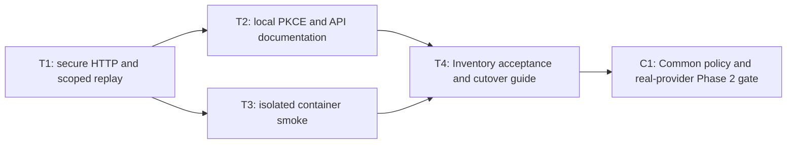

# Inventory HTTP security implementation tasks

Status: Planned; no task below is implemented by the specification request.

## Delivery rules and dependencies

Each task is one safe commit. Inventory implementation requires a separate request. T1 is the
coherent authentication/authorization/replay cutover: splitting enforcement from identity-scoped
replay would create an unsafe interim boundary. Review it as one change with focused tests.
T2 and T3 build on T1; T4 is final Inventory acceptance. C1 is a separately requested Common commit,
with its own repository rules, and is not a task to execute inside this repository.

Do not deploy an intermediate task commit as completed Phase 2. T1 changes the ledger primary
key, so use the coordinated offline cutover described in `design.md` §5; old and new binaries
must not share that schema. Every Inventory task runs mvn -B -ntp clean verify and requires
BUILD SUCCESS without skip flags. Formatting failures require mvn spotless:apply followed by the
full lifecycle. Run the Inventory container smoke after its security adaptation and whenever
container/runtime configuration changes; no phase-specific suite waives a repository gate.

## T1 — Enforce resource-server and business security with scoped replay

**Commit:** feat: secure inventory HTTP operations and isolate authenticated replays

**Depends on:** Agreed specification and an Inventory implementation request.

**Refs.** `requirements.md` AC1.1, AC1.2, AC1.3, AC1.4, AC1.5, AC2.1, AC2.2, AC2.3,
AC2.4, AC2.5, AC3.1, AC3.2, AC3.3, AC3.4, AC3.5, AC4.1, AC4.2, AC4.3, AC4.4, AC4.5,
AC4.6, AC5.1, AC5.2, AC5.3, AC5.4, AC6.2, AC6.3, AC6.5, AC7.1; `design.md` §1, §2,
§3, §4, §5, §6, §7, §8.

**Scope.** Add the Boot-managed resource-server/test support, deliberately replace Maven and
ArchUnit Security bans, implement validation/conversion, explicit listener-aware chains,
caller-specific HTTP and proxied-service rules, sanitized errors/denial telemetry and the scoped
ledger migration. Adapt existing full-stack tests to intended credentials and add an ephemeral
signed-JWT/JWKS fixture. Keep docs disabled by default. Preserve internal Kafka and cleanup paths.

**DoD.**

- Signed HTTP requests exercise every required token check and its negative cases: signature,
  RS256-only policy, JOSE/payload type, exact issuer, string/array audience, identity/time claims,
  30s boundaries and role-structure types. Missing, duplicate, malformed, query/form-only tokens
  assert generic 401, proper challenges and zero business/replay access. Unknown roles, realm
  roles, other-resource roles and SCOPE_ authorities never satisfy local permissions.
- Tests start the application with valid settings and unreachable JWKS, warm cached keys before
  outage, accept a known-key token while cached, reject an unknown kid within configured fetch
  bounds and refresh keys on recovery. Missing/invalid configuration fails startup. Keycloak
  availability never becomes a probe dependency; tests assert 2s fetch timeout settings.
- Every permission-matrix row has positive and negative HTTP assertions, including customer and
  staff roles, exact machine azp, unapproved clients and accidental overgrants. Pricing can only
  GET one item; Reservation can only PATCH all-RESERVED batches. A forbidden defined target or
  mixed-target batch yields 403 before ledger/item access, and a non-AVAILABLE source returns
  unchanged atomic 409 behavior. Authorized missing-only batches retain 404. HEAD/OPTIONS and
  unmatched routes fail closed; denied existing/nonexistent serials both return 403.
- Actual proxied service invocations reject missing/insufficient authentication and forbidden
  Reservation targets; replay cannot bypass these checks. Method denials assert 403 Problem
  Details rather than the advice catch-all's 500. Kafka cancellation and scheduled cleanup still
  execute without human credentials, with all existing inbox/history/retry guarantees.
- V1–V4-to-V5 migration assertions preserve a legacy outcome/expiry, verify composite identity,
  scope constraints and expiry index, and preserve Inventory ownership/other-service sentinels.
  Legacy saved rows are never replayed to an authenticated caller. No shipped migration changes.
- PostgreSQL tests use equal UUIDs under two subjects to prove independent outcomes and locks;
  renewed tokens and another approved client for one subject replay the same saved outcome.
  Changed permissions and forbidden targets are rejected before replay; valid replay after item
  changes/deletion remains intact. Same-scope 409 busy/Retry-After, 422 mismatch, seven-day expiry,
  terminal headers, restart and rollback assertions preserve their existing exact contracts.
- Cleanup tests place equal keys in legacy and multiple authenticated scopes with mixed expiry,
  and prove only the selected expired composite rows are removed, including SKIP LOCKED,
  1000-row chunk and runtime-budget behavior. Items/history and unexpired rows remain unchanged.
- Tests on both actual listeners assert anonymous minimal probes/private metrics, unchanged DB
  readiness/liveness semantics, no management exposure on the API port, and denial of business,
  docs and unapproved endpoints on management. Spoofed Host/forwarded headers cannot change
  listener classification. Default-disabled documentation has no generated or accessible routes.
- Requests assert no login redirect, security cookie/session or Basic/form authentication and no
  CORS allowance. Filter and method denials match exact status/type/title/code/detail/challenges,
  omit replay headers and unsafe descriptions, and ignore Accept for their safe error shape.
  Captured responses/logs/spans/metric labels exclude synthetic token/identity/body markers;
  denial metrics have only the specified bounded reason/surface labels.
- Existing batch matrix, CRUD, arbitrary staff POST/PUT status without new history, idempotency,
  migration, retention, observability and Kafka suites pass with intended credentials. New
  architecture assertions retain layer directions and exclude Security from persistence/domain
  types. mvn -B -ntp clean verify reports BUILD SUCCESS.

## T2 — Wire local Swagger PKCE and document API authorization

**Commit:** docs: expose local PKCE exploration for the secured inventory API

**Depends on:** T1.

**Refs.** `requirements.md` AC6.1, AC6.2, AC6.4; `design.md` §3, §5, §6, §7, §9.

**DoD.**

- Running-server/OpenApiIT assertions prove local-only anonymous Swagger/OpenAPI availability,
  both generators disabled by default, and no management-listener docs allowance. UI config
  contains exact inventory-swagger client ID, issuer-derived endpoints, S256 PKCE enabled,
  openid scope, disabled persistence and no client secret.
- OpenAPI assertions verify bearer and authorizationCode alternatives, empty RBAC-as-scope
  lists, required security on all business operations, exact permission/caller descriptions,
  401/403 ProblemResponse schemas and unchanged business schemas/headers. The README covers
  PKCE callback/origin requirements, role matrix, scoped replay, credential setup without secret
  output, and the five-minute-plus-skew revocation limitation.
- Documentation/route tests show public docs do not grant anonymous business access and do not
  admit unconfigured cross-origin requests. mvn -B -ntp clean verify reports BUILD SUCCESS.

## T3 — Make the Inventory container smoke isolated and authenticated

**Commit:** test: verify secured inventory in an isolated container stack

**Depends on:** T1. Can be developed independently of T2 after T1; final execution includes T2.

**Refs.** `requirements.md` AC7.2; `design.md` §2, §5, §7, §8.

**DoD.**

- scripts/container-smoke-test.sh uses only its own Compose project, test-only override/JWKS
  runner, fresh signing keys/tokens and volume; it works without Common or a developer's realm.
  Fixture/test image versions are pinned, generated credentials remain private, tokens never
  appear in argv/logs, and teardown removes only smoke-owned resources.
- The script asserts no-token 401, customer read/list and write denial, staff setup/read/write,
  Pricing lookup-only access, Reservation claim-only access with forbidden-target 403, and
  equal-key isolation across two subjects. It checks denied requests leave state unchanged.
- Existing runtime UID/tooling, schema/bootstrap, private metrics, ECS logs, persistence across
  restart/recreation, DB outage generic errors, independent liveness and recovery checks pass
  using valid credentials where business processing is expected. No HTTP auth bypass is added.
- mvn -B -ntp clean verify reports BUILD SUCCESS and ./scripts/container-smoke-test.sh reports
  Container smoke verification passed, including cleanup after an intentionally failed assertion.

## T4 — Record Inventory acceptance and the coordinated cutover

**Commit:** docs: record inventory security acceptance and rollout procedure

**Depends on:** T1, T2, T3.

**Refs.** `requirements.md` AC7.1, AC7.2, AC7.4; `design.md` §5, §8, §9.

**DoD.**

- Review records link every AC to its implementation assertions and resolve all failures in
  Inventory acceptance; any pending external Common evidence is explicitly named rather than
  presented as completed. Spec self-evaluation is recorded without inventing runtime results.
- A cutover guide describes stopping old instances/draining writes, backup, V5 application,
  schema-compatible deployment, fresh keys and reconciliation of uncertain legacy operations.
  It prohibits mixed old/new binaries, attributing legacy outcomes and automatic write replay.
- The guide explicitly marks Pricing/Reservation workflows pending until Phases 3/4, forbids
  weakening Inventory enforcement and retains Common's full combined-smoke and Phase 5/7 gates.
- A final mvn -B -ntp clean verify reports BUILD SUCCESS and the adapted container smoke reports
  Container smoke verification passed; record dates, scope and unskipped suite counts.

## C1 — Common policy and real-provider interoperability handoff

**Commit (Common repository):** feat: provision and verify inventory human permissions

**Depends on:** T4 and a separate Common-scoped implementation request. This is an external
Phase 2 completion gate; Inventory local acceptance may be reported before it, with this gate pending.

**Refs.** `requirements.md` AC7.3, AC7.4; `design.md` §3, §7, §9.

**DoD.**

- Common's desired template/policy and independent verification expectations grant CUSTOMER
  read/list and STAFF read/list/manage/history, expose only those human roles in the two
  Inventory interactive scopes, and preserve exact machine audiences/read-or-reserve grants.
  A policy plan/apply/read-back and no-op second apply preserve existing subjects/keys/secrets.
- In an isolated realm, real browser PKCE tokens and machine Client Credentials tokens pass
  Inventory's direct setup/read/list/claim checks and all negative checks named in the handoff,
  including forbidden-target and permission-reduced replay with unchanged denied-write state.
  No password grant or token diagnostics are introduced for test convenience.
- Common's direct Inventory smoke requests use intended identities; unchanged caller workflows
  are explicitly pending, and Phase 2 evidence is labeled accordingly. No Common Compose change
  is made unless its complete required suite can report Combined container smoke verification
  passed; otherwise defer affected Compose changes and use existing injection/test overrides.

## Acceptance-criteria traceability

Each T1 DoD assertion group corresponds to the exact behavior in its cited design sections;
T2/T3/C1 add configuration, container and real-provider evidence rather than replacing T1 tests.

| Acceptance criteria | Task with regression-sensitive DoD |
| --- | --- |
| AC1.1, AC1.2, AC1.3, AC1.4 | T1 signed-token, resolver and authority assertions |
| AC1.5 | T1 startup/cache/outage/timeout and probe assertions |
| AC2.1, AC2.2, AC2.4, AC2.5 | T1 complete caller/permission/route matrix and proxied calls |
| AC2.3 | T1 arbitrary staff POST/PUT status/history regressions |
| AC3.1, AC3.2, AC3.3, AC3.4, AC3.5 | T1 machine allowlist, overgrant, target and lifecycle assertions |
| AC4.1, AC4.2, AC4.3 | T1 scoped persistence/locks, renewed/cross-client replay and authorization-before-replay |
| AC4.4 | T1 legacy migration/preservation and no-replay assertions |
| AC4.5 | T1 cleanup by composite identity with equal UUIDs/mixed expiry |
| AC4.6 | T1 transaction-failure/rollback and safe retry assertions |
| AC5.1, AC5.2, AC5.3, AC5.4 | T1 actual listener, minimal probe, spoofing and statelessness assertions |
| AC6.1, AC6.2 | T2 local/default-disabled documentation and PKCE config assertions; T1 default denial |
| AC6.3, AC6.5 | T1 exact filter/method denial contract and telemetry leakage assertions |
| AC6.4 | T2 OpenAPI and README contract assertions |
| AC7.1 | T1 isolated signed HTTP/proxy/PostgreSQL regression suites; T4 final evidence |
| AC7.2 | T3 isolated smoke allow/deny/replay/runtime assertions; T4 final execution |
| AC7.3 | C1 real-provider policy and API positive/negative assertions |
| AC7.4 | T4 rollout-guide gate assertions and C1 explicit pending-workflow reporting |
