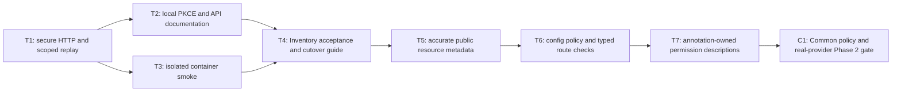

# Inventory HTTP security implementation tasks

Status: T1–T7 implemented in Inventory. Common C1 delivered in a510b07 on 2026-11-12;
subsequent Pricing/Reservation rollout and combined acceptance recorded through 2026-11-24.
Reviewed on 2026-11-25; see the verification status and test references below and `design.md` §9
for evidence boundaries and deployment limits.

## Delivery rules and dependencies

Each task describes one safe commit; implementation was separately authorized. T1 is the
coherent authentication/authorization/replay cutover: splitting enforcement from identity-scoped
replay would create an unsafe interim boundary. Review it as one change with focused tests.
T2 and T3 build on T1; T4 is final Inventory acceptance. C1 is a separately requested Common commit,
with its own repository rules, and is not a task to execute inside this repository.
T5 is the user-approved 2026-11-11 metadata amendment after the original Inventory acceptance,
including the subsequent explicit simplification to native Spring URL generation.
T6 is the subsequent user-approved authorization policy/route-binding refactor with unchanged behavior.
T7 is the user-approved 2026-11-12 refactor of per-operation security documentation.

Do not deploy an intermediate task commit as completed Phase 2. T1 changes the ledger primary
key, so use the coordinated offline cutover described in `design.md` §5; old and new binaries
must not share that schema. Every Inventory task runs mvn -B -ntp clean verify and requires
BUILD SUCCESS without skip flags. Formatting failures require mvn spotless:apply followed by the
full lifecycle. Run the Inventory container smoke after its security adaptation and whenever
container/runtime configuration changes; no phase-specific suite waives a repository gate.

## T1 — Enforce resource-server and business security with scoped replay

**Commit:** feat: secure inventory HTTP operations and isolate authenticated replays

**Depends on:** Agreed specification and an Inventory implementation request.

**Refs.** `requirements.md` AC1.1, AC1.2, AC1.3, AC1.4, AC1.5, AC1.6, AC2.1, AC2.2, AC2.3,
AC2.4, AC2.5, AC3.1, AC3.2, AC3.3, AC3.4, AC3.5, AC4.1, AC4.2, AC4.3, AC4.4, AC4.5,
AC4.6, AC5.1, AC5.2, AC5.3, AC5.4, AC6.2, AC6.3, AC6.5, AC7.1; `design.md` §1, §2,
§3, §4, §5, §6, §7, §8.

**Scope.** Add the Boot-managed resource-server/test support, deliberately replace Maven and
ArchUnit Security bans, implement validation/conversion, explicit listener-aware chains,
caller-specific HTTP and proxied-service rules, sanitized errors/denial telemetry and the scoped
ledger migration. Adapt existing full-stack tests to intended credentials and add an ephemeral
signed-JWT/JWKS fixture. Keep docs disabled by default. Preserve internal Kafka and cleanup paths.

**DoD.**

- Signed HTTP requests exercise every required token check and its negative cases: signature,
  RS256-only policy, JOSE/payload type, exact issuer, string/array audience, identity/time claims,
  30s boundaries and role-structure types. Missing, duplicate, malformed, query/form-only tokens
  assert generic 401, proper challenges and zero business/replay access. Unknown roles, realm
  roles, other-resource roles and SCOPE_ authorities never satisfy local permissions.
- Header-type tests accept JWT, jwt and mixed case while rejecting absent, blank and other
  types; payload typ still requires exact Bearer. Composed built-ins preserve required expiry,
  optional nbf, exact issuer, both audience representations and 30s clock boundaries. An
  unexpired token issued more than 30s ago remains valid. Malformed claim shapes yield generic
  401 without conversion exceptions, and decoder tests retain RS256-only signature enforcement.
- Tests start the application with valid settings and unreachable JWKS, warm cached keys before
  outage, accept a known-key token while cached, reject an unknown kid within configured fetch
  bounds and refresh keys on recovery. Missing/invalid configuration fails startup. Keycloak
  availability never becomes a probe dependency; tests assert 2s fetch timeout settings.
- Every permission-matrix row has positive and negative HTTP assertions, including customer and
  staff roles, exact machine azp, unapproved clients and accidental overgrants. Pricing can only
  GET one item; Reservation can only PATCH all-RESERVED batches. A forbidden defined target or
  mixed-target batch yields 403 before ledger/item access, and a non-AVAILABLE source returns
  unchanged atomic 409 behavior. Authorized missing-only batches retain 404. HEAD/OPTIONS and
  unmatched routes fail closed; denied existing/nonexistent serials both return 403.
- Actual proxied service invocations reject missing/insufficient authentication and forbidden
  Reservation targets; replay cannot bypass these checks. Method denials assert 403 Problem
  Details rather than the advice catch-all's 500. Kafka cancellation and scheduled cleanup still
  execute without human credentials, with all existing inbox/history/retry guarantees.
- V1–V4-to-V5 migration assertions preserve a legacy outcome/expiry, verify composite identity,
  scope constraints and expiry index, and preserve Inventory ownership/other-service sentinels.
  Legacy saved rows are never replayed to an authenticated caller. No shipped migration changes.
- PostgreSQL tests use equal UUIDs under two subjects to prove independent outcomes and locks;
  renewed tokens and another approved client for one subject replay the same saved outcome.
  Changed permissions and forbidden targets are rejected before replay; valid replay after item
  changes/deletion remains intact. Same-scope 409 busy/Retry-After, 422 mismatch, seven-day expiry,
  terminal headers, restart and rollback assertions preserve their existing exact contracts.
- Cleanup tests place equal keys in legacy and multiple authenticated scopes with mixed expiry,
  and prove only the selected expired composite rows are removed, including SKIP LOCKED,
  1000-row chunk and runtime-budget behavior. Items/history and unexpired rows remain unchanged.
- Tests on both actual listeners assert anonymous minimal probes/private metrics, unchanged DB
  readiness/liveness semantics, no management exposure on the API port, and denial of business,
  docs and unapproved endpoints on management. Spoofed Host/forwarded headers cannot change
  listener classification. Default-disabled documentation has no generated or accessible routes.
- Requests assert no login redirect, security cookie/session or Basic/form authentication and no
  CORS allowance. Filter and method denials match exact status/type/title/code/detail/challenges,
  omit replay headers and unsafe descriptions, and ignore Accept for their safe error shape.
  Captured responses/logs/spans/metric labels exclude synthetic token/identity/body markers;
  denial metrics have only the specified bounded reason/surface labels.
- Existing batch matrix, CRUD, arbitrary staff POST/PUT status without new history, idempotency,
  migration, retention, observability and Kafka suites pass with intended credentials. New
  architecture assertions retain layer directions and exclude Security from persistence/domain
  types. mvn -B -ntp clean verify reports BUILD SUCCESS.

## T2 — Wire local Swagger PKCE and document API authorization

**Commit:** docs: expose local PKCE exploration for the secured inventory API

**Depends on:** T1.

**Refs.** `requirements.md` AC6.1, AC6.2, AC6.4; `design.md` §3, §5, §6, §7, §9.

**DoD.**

- Running-server/OpenApiIT assertions prove local-only anonymous Swagger/OpenAPI availability,
  both generators disabled by default, and no management-listener docs allowance. UI config
  contains exact inventory-swagger client ID, issuer-derived endpoints, S256 PKCE enabled,
  openid scope, disabled persistence and no client secret.
- OpenAPI assertions verify bearer and authorizationCode alternatives, empty RBAC-as-scope
  lists, required security on all business operations, exact permission/caller descriptions,
  401/403 ProblemResponse schemas and unchanged business schemas/headers. The README covers
  PKCE callback/origin requirements, role matrix, scoped replay, credential setup without secret
  output, and the five-minute-plus-skew revocation limitation.
- Documentation/route tests show public docs do not grant anonymous business access and do not
  admit unconfigured cross-origin requests. mvn -B -ntp clean verify reports BUILD SUCCESS.

## T3 — Make the Inventory container smoke isolated and authenticated

**Commit:** test: verify secured inventory in an isolated container stack

**Depends on:** T1. Can be developed independently of T2 after T1; final execution includes T2.

**Refs.** `requirements.md` AC7.2; `design.md` §2, §5, §7, §8.

**DoD.**

- scripts/container-smoke-test.sh uses only its own Compose project, test-only override/JWKS
  runner, fresh signing keys/tokens and volume; it works without Common or a developer's realm.
  Fixture/test image versions are pinned, generated credentials remain private, tokens never
  appear in argv/logs, and teardown removes only smoke-owned resources.
- The script asserts no-token 401, customer read/list and write denial, staff setup/read/write,
  Pricing lookup-only access, Reservation claim-only access with forbidden-target 403, and
  equal-key isolation across two subjects. It checks denied requests leave state unchanged.
- Existing runtime UID/tooling, schema/bootstrap, private metrics, ECS logs, persistence across
  restart/recreation, DB outage generic errors, independent liveness and recovery checks pass
  using valid credentials where business processing is expected. No HTTP auth bypass is added.
- mvn -B -ntp clean verify reports BUILD SUCCESS and ./scripts/container-smoke-test.sh reports
  Container smoke verification passed, including cleanup after an intentionally failed assertion.

## T4 — Record Inventory acceptance and the coordinated cutover

**Commit:** docs: record inventory security acceptance and rollout procedure

**Depends on:** T1, T2, T3.

**Refs.** `requirements.md` AC7.1, AC7.2, AC7.4; `design.md` §5, §8, §9.

**DoD.**

- Review records link every AC to its implementation assertions and resolve all failures in
  Inventory acceptance; any pending external Common evidence is explicitly named rather than
  presented as completed. Spec self-evaluation is recorded without inventing runtime results.
- A cutover guide describes stopping old instances/draining writes, backup, V5 application,
  schema-compatible deployment, fresh keys and reconciliation of uncertain legacy operations.
  It prohibits mixed old/new binaries, attributing legacy outcomes and automatic write replay.
- The guide explicitly marks Pricing/Reservation workflows pending until Phases 3/4, forbids
  weakening Inventory enforcement and retains Common's full combined-smoke and Phase 5/7 gates.
- A final mvn -B -ntp clean verify reports BUILD SUCCESS and the adapted container smoke reports
  Container smoke verification passed; record dates, scope and unskipped suite counts.

## T5 — Retain Spring's public protected-resource metadata

**Commit:** feat: publish accurate inventory protected-resource metadata

**Depends on:** T4 and the user's 2026-11-11 metadata implementation request, with their later explicit simplification superseding the fixed-origin decisions.

**Refs.** `requirements.md` AC1.2, AC2.5, AC5.3, AC5.5, AC5.6, AC6.3, AC6.4, AC7.1,
AC7.2; `design.md` §3, §6, §7.1, §8, §9.

**DoD.**

- The application retains Spring's metadata filter and uses supported metadata customization,
  with no filter-list reconstruction. Real HTTP tests assert exactly resource,
  authorization_servers, bearer_methods_supported=["header"] and
  tls_client_certificate_bound_access_tokens=false; OAuth scopes and credential data are absent.
  Root, trailing-slash, nested and encoded suffixes use Spring's effective request-derived
  resource URL and omit query parameters. Tests assert the real listener origin and different
  effective schemes/hosts/ports, retaining the exact four-field response checks.
- Remove the public-origin environment/property settings from application/local YAML, Compose,
  smoke overrides and test fixtures, together with URL rewriting and its startup validator.
  Replace obsolete fixed-origin/validation tests with request-URL assertions. README documents
  standard trusted proxy/forwarding deployment responsibilities and the issuer/audience
  distinction without adding custom header processing or a new required setting.
- Metadata GET tests with missing, valid, malformed and duplicate bearer headers return the
  same public document, including during a JWKS outage with documentation disabled. Private
  management discovery stays 403 with no challenge, non-GET/unrelated well-known requests stay
  denied, and signed business/probe/docs regressions retain their authentication and permission
  checks. Existing WWW-Authenticate headers remain exact and unchanged.
- Update the former discovery-denial tests to assert the approved public protocol contract;
  retain independent listener and business-denial assertions. The isolated container smoke
  verifies configured metadata without removing runtime/outage/replay checks. Re-run the spec
  checklist, mvn -B -ntp clean verify (BUILD SUCCESS, no skipped checks), and the container smoke
  (Container smoke verification passed); update the verification status and test references below.

## T6 — Separate capability policy, route selection and caller scoping

**Commit:** refactor: bind inventory routes to a shared config authorization policy

**Depends on:** T5 and the user's explicit authorization-refactor request.

**Refs.** `requirements.md` AC1.1, AC1.2, AC2.1, AC2.2, AC2.4, AC2.5, AC3.1, AC3.2,
AC3.3, AC3.5, AC4.1, AC4.2, AC4.3, AC6.3, AC7.1, AC7.2; `design.md` §1, §3.1, §4,
§5, §6, §8.

**DoD.**

- InventoryAuthorizationPolicy lives in config as a plain class with unchanged capability
  predicates and annotation-facing overloads. Its unconditional @Bean registration in
  InventoryMethodSecurityConfig resolves in both servlet and non-web service contexts. All
  service annotations use the new bean name. The former service class, generic authorize
  dispatcher and HTTP-path/method parsing are removed; existing ArchUnit rules pass unchanged.
- applicationSecurity binds its existing routes to typed callbacks for read/list/history/manage
  and request-transition capabilities. Signed HTTP tests with single human permissions catch
  incorrect route bindings and preserve 403 before malformed-body parsing for denied writes.
  Existing customer/staff/machine, overgrant, target, HEAD/OPTIONS and unknown-route assertions
  remain intact, as do exact 401/403/challenge and public metadata/probe/docs behavior.
- callerScope lives in IdempotentStatusTransitionService with package visibility. A fixed
  namespace/issuer/subject hash vector remains exact across approved clients, missing identity
  is rejected, and existing equal-key/renewed-token/cross-client replay, lock and database
  regression assertions pass. No migration or stored identity is changed.
- Actual service proxies and non-web idempotency restart contexts retain authorization and
  target checks, including before saved-result access. No service acquires a Java dependency on
  config, and no policy is moved to util or given a repository dependency. Record a new spec
  review, mvn -B -ntp clean verify (BUILD SUCCESS, no skipped checks) and the isolated container
  smoke (Container smoke verification passed) in the verification status below.

## T7 — Attach permission documentation to controller operations

**Commit:** refactor: document inventory permissions on controller operations

**Depends on:** T6 and the user's explicit documentation-refactor request.

**Refs.** `requirements.md` AC6.1, AC6.3, AC6.4, AC7.1; `design.md` §3, §4, §5, §6, §7, §8.

**DoD.**

- All seven business operations document their own permission and caller restrictions in their
  existing @Operation descriptions. Preserve POST/PUT status-assignment semantics, PATCH's
  existing business description, human-manage and Reservation-reserve alternatives, all-RESERVED
  restriction and authorization before replay. The Idempotency-Key parameter describes verified
  issuer/subject scope. No operationId switch or fallback permission description remains.
- The existing OpenApiCustomizer retains both authentication schemes, both alternatives with
  empty permission-scope lists and common 401/403 ProblemResponse/WWW-Authenticate documentation.
  It does not rewrite descriptions. No new annotation/catalog abstraction or runtime policy,
  filter-chain, service-security or dependency-boundary change is introduced.
- OpenApiIT verifies permission/caller text for each HTTP method/path and the PATCH replay/key
  contract, as well as shared scheme definitions and exact error documentation on all operations.
  Existing business-schema, PKCE and runtime authorization assertions remain intact. Record a
  spec self-evaluation and mvn -B -ntp clean verify with BUILD SUCCESS and no skipped checks in
  the verification status below. Container/runtime configuration is unchanged; prior container
  acceptance remains separately dated evidence.

## C1 — Common policy and real-provider interoperability handoff

**Commit (Common repository):** feat: provision and verify inventory human permissions

**Status:** Completed by Common commit a510b07 (2026-11-12); reviewed against current Common
HEAD 75afd1f on 2026-11-25. Common SECURITY_SPEC.md §15 records the original Inventory gate;
§16/§17 record subsequent authenticated callers and combined acceptance. Current verification
results and test references are maintained below.

**Depends on:** T7 and the separately authorized Common implementation. Inventory-local
acceptance preceded this external Phase 2 gate; it is no longer pending in the reviewed checkout.

**Refs.** `requirements.md` AC7.3, AC7.4; `design.md` §3, §7, §9.

**DoD.**

- Common's desired template/policy and independent verification expectations grant CUSTOMER
  read/list and STAFF read/list/manage/history, expose only those human roles in the two
  Inventory interactive scopes, and preserve exact machine audiences/read-or-reserve grants.
  A policy plan/apply/read-back and no-op second apply preserve existing subjects/keys/secrets.
- In an isolated realm, real browser PKCE tokens and machine Client Credentials tokens pass
  Inventory's direct setup/read/list/claim checks and all negative checks named in the handoff,
  including forbidden-target and permission-reduced replay with unchanged denied-write state.
  No password grant or token diagnostics are introduced for test convenience.
- Common's direct Inventory smoke requests and subsequent Pricing/Reservation workflows use
  intended identities. Label scoped Phase 2, later caller and full combined evidence separately;
  keep pending status only while a caller has not adopted Client Credentials. Common Compose
  changes require Combined container smoke verification passed; the recorded 2026-11-24 run
  supplies that completed gate on disposable storage, without waiving future runs or Phase 5/7.

## Regression test entry points

Each T1 DoD assertion group corresponds to the exact behavior in its cited design sections;
T2/T3/C1 add configuration, container and real-provider evidence rather than replacing T1 tests.

Test classes below live under src/test/java/com/rentflow; Common scripts run from Common's root.

| Acceptance criteria | Task with regression-sensitive DoD | Test entry points |
| --- | --- | --- |
| AC1.1, AC1.2, AC1.3, AC1.4 | T1 signed-token, resolver and authority assertions | SecurityIT.validatesRealSignaturesAlgorithmsTokenTypesAndAllRequiredClaims; rejectsMissingMalformedDuplicateAndNonHeaderCredentialsWithSafeChallenges; converter/InventoryAuthorityConverterTest |
| AC1.5 | T1 startup/cache/outage/timeout and probes | config/InventorySecurityConfigTest.createsDecoderWithoutNetworkAndUsesCachedKeysDuringOutageThenRefreshes; ObservabilityIT |
| AC1.6 | T1 case-insensitive header and exact payload type | config/InventoryJwtValidatorTest; SecurityIT.acceptsCaseInsensitiveRequiredJwtHeaderAndPreservesPayloadTypeAndOlderTokenValidation |
| AC2.1, AC2.2, AC2.4, AC2.5 | T1 caller/permission/route matrix and proxies; T6 typed early checks | SecurityIT.enforcesHumanMachineAndRoutePermissionMatrixEvenWithAccidentalOvergrants; bindsEachRouteToItsSpecificCapabilityBeforeBodyValidation; proxied-service tests |
| AC2.3 | T1 arbitrary staff POST/PUT status without history | InventoryIT create/replace status/history assertions |
| AC3.1, AC3.2, AC3.3, AC3.4, AC3.5 | T1/T6 machine allowlists, overgrants, target and lifecycle checks | SecurityIT caller matrix and rejectsForbiddenReservationTargetsBeforeReplayLocksOrItemMutation; InventoryIT batch matrix; scripts/container-smoke-test.sh |
| AC4.1, AC4.2, AC4.3 | T1/T6 scoped storage/locks, stable identity and authorization before replay | SecurityIT.isolatesEqualKeysAcrossSubjectsAndRechecksPermissionsBeforeSavedResults; service/IdempotencyIT.heldExecutionLockDoesNotBlockAnotherSubjectUsingTheSameUuid; IdempotentStatusTransitionServiceTest caller-scope vectors and non-web restart/replay tests |
| AC4.4 | T1 legacy migration/preservation and no replay | SecurityMigrationIT.upgradesLegacyLedgerWithoutLosingOutcomesOrOtherServiceObjects; SecurityIT legacy isolation |
| AC4.5 | T1 composite cleanup with equal UUIDs/mixed expiry | SecurityIT.cleansOnlyExpiredCompositeRowsAndNeverReplaysLegacyResults; service/IdempotencyIT cleanup/chunk/locking assertions |
| AC4.6 | T1 rollback and safe retry | InventoryIT and service/IdempotencyIT injected persistence failures |
| AC5.1, AC5.2, AC5.3, AC5.4 | T1 real listeners, probes, spoofing and statelessness | SecurityIT.isolatesRealManagementListenerAndDisablesDocs; credential/session/method denials; ObservabilityIT; scripts/container-smoke-test.sh |
| AC5.5, AC5.6 | T5 exact metadata/native URLs and listener isolation | SecurityIT.publishesAccuratePublicMetadataUsingRequestUrlsAndNativeResourcePaths; publicMetadataDoesNotAuthenticateCredentialsOrContactUnavailableProvider; metadataNonGetMethodsRetainNormalAuthenticationAndDenyRules |
| AC6.1, AC6.2 | T2 local/default-disabled docs and PKCE; T1 default denial | OpenApiIT.exposesPkceConfigurationWithoutSecretsOrPersistentAuthorization; SecurityIT real-listener docs checks |
| AC6.3, AC6.5 | T1/T6 exact filter/method denials and bounded telemetry | SecurityIT.deniesDoNotLeakCredentialsOrBodiesAndUseOnlyBoundedMetricLabels; proxied-service denials; ObservabilityIT.securityDenialTracesExcludeCredentialsBodiesAndAuthorizationDetails |
| AC6.4 | T2/T7 OpenAPI/README contract | OpenApiIT.documentsEachOperationsPermissionsCallersAndReplayScope; documentsSharedAuthenticationAlternativesAndSecurityResponses |
| AC7.1 | T1 isolated signed/proxy/database verification; T4 final evidence | Full mvn -B -ntp clean verify lifecycle, including SecurityIT, migration and real-broker suites |
| AC7.2 | T3/T4 isolated container/runtime/replay and cleanup | scripts/container-smoke-test.sh; INVENTORY_SMOKE_FAIL_AFTER_SETUP=1 cleanup check |
| AC7.3 | C1 real-provider policy and API assertions | Common scripts/security-smoke-test.sh --inventory and scripts/security/inventory_check.py |
| AC7.4 | T4/C1 phased rollout and combined gate | README cutover guide; design.md §9; Common scripts/container-smoke-test.sh |

## Verification status

Keep this summary current rather than appending a per-refactor execution history. Runtime
contracts belong in requirements/design, operational instructions in README, and test behavior
in the executable suites above.

| Gate | Latest recorded result |
| --- | --- |
| Inventory Maven lifecycle | 2026-11-25: BUILD SUCCESS; 106 unit/architecture and 203 integration tests, zero failures/errors/skips; Spotless clean |
| Inventory isolated container smoke | 2026-11-11: Container smoke verification passed, including signed caller/replay checks, native metadata, private metrics, restart, DB outage/recovery, retained-volume recreation and cleanup; intentional-failure cleanup also verified during initial acceptance |
| Common real-provider Inventory gate | 2026-11-25: Keycloak foundation smoke verification passed and Inventory security interoperability verification passed; smoke containers/volumes/networks and temporary credentials removed |
| Common full combined gate | Recorded by Common SECURITY_SPEC.md §17 on 2026-11-24: Combined container smoke verification passed; reviewed rather than rerun during the 2026-11-25 Inventory review |

The Common rerun used disposable rentflow-security-smoke resources and checked-free ports;
developer realm/state was not modified. Existing-realm policy application, existing-data cutover
and broader operational/production-hardening obligations remain as described in `design.md` §9
and README. Historical implementation changes and verification records remain available in Git.
